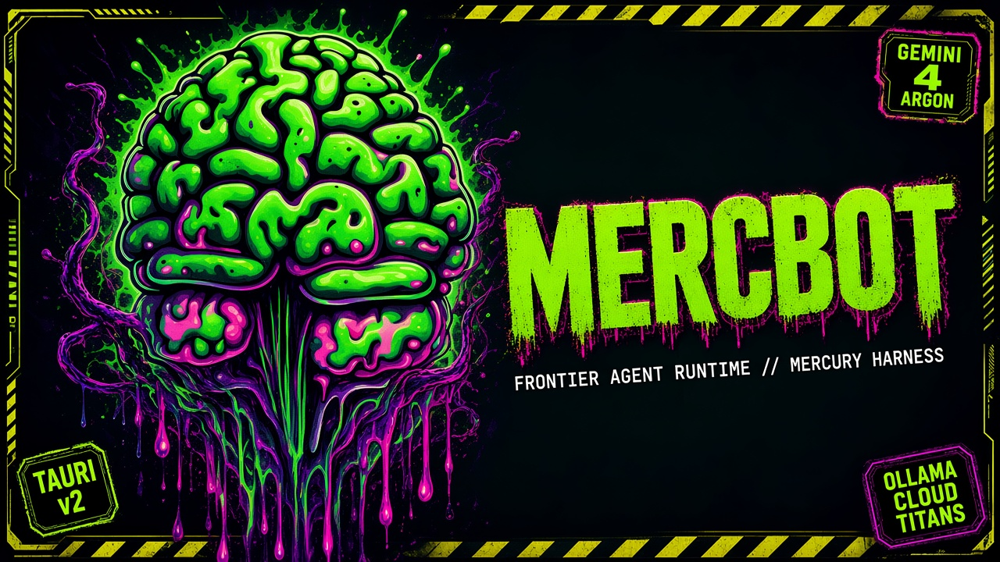
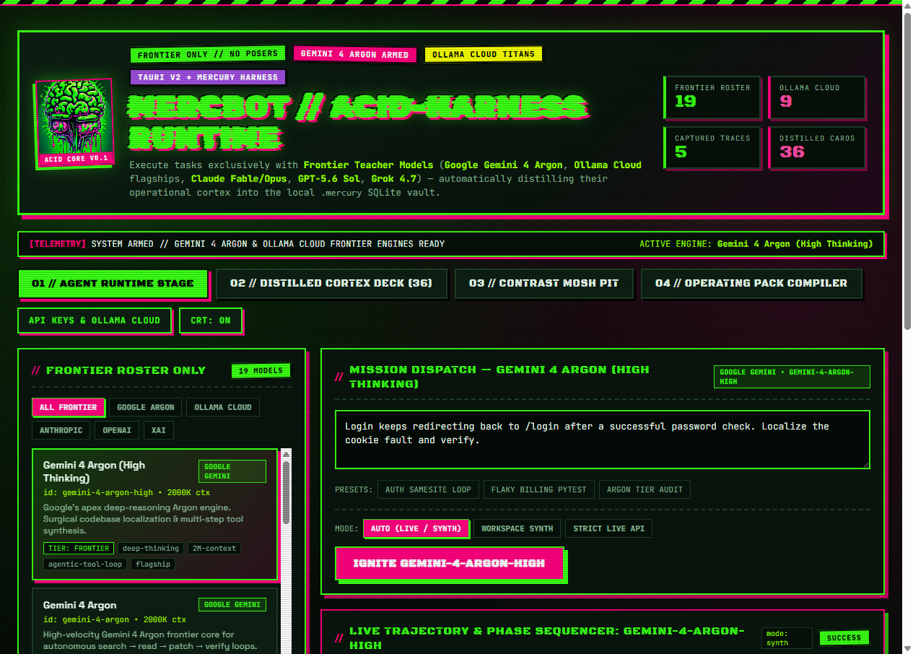
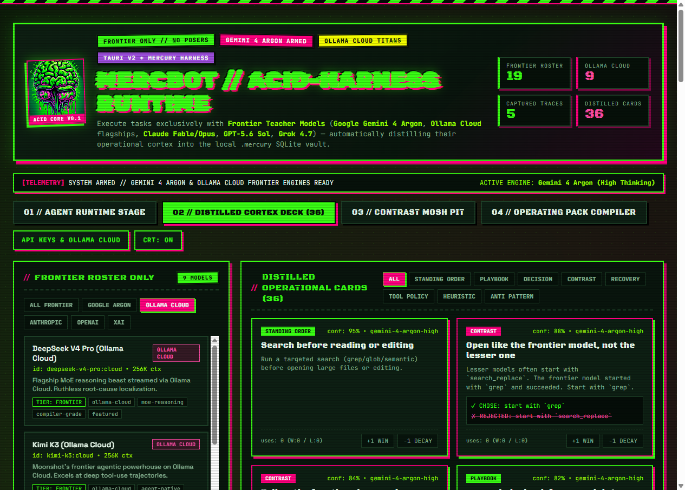

# MERCBOT // Acid-Harness Frontier Agent Runtime



> **FRONTIER ONLY // NO POSERS.**  
> An acid-punk **Frontier Agent Runtime** & **Tauri v2 Desktop App** built on top of the **Mercury Harness** — executing multi-step agent trajectories exclusively with **Google Gemini 4 Argon**, **Ollama Cloud Titans**, **Anthropic Fable/Opus**, **OpenAI GPT-5.6 Sol**, and **xAI Grok 4.7**, while distilling how frontier models operate into a local `.mercury` operational cortex.

---

## Live Acid-Punk Tauri v2 Interface

| 01 // Agent Runtime Stage | 02 // Distilled Cortex Deck & Ollama Cloud Roster |
|---|---|
|  |  |

---

## What Makes MercBot Slap

1. **Strictly Frontier-Only Gatekeeper (`FrontierOnlyError`)**
   - Lesser and mid-tier models (`gpt-4o-mini`, `claude-haiku-4`, `gemini-3.5-flash`, `gpt-oss:20b`, etc.) are **bounced at the door** when invoking the runtime.
   - Only verified `ModelTier.FRONTIER` teacher models are listed and permitted to execute trajectories in the runtime.
2. **Google Gemini 4 Argon + Ollama Cloud Flagships First-Class**
   - Native multi-turn tool-calling adapters for **Google Gemini** (`gemini-4-argon-high`, `gemini-4-argon`, `gemini-3.1-pro` with `thoughtSignature` preservation) and **Ollama Cloud** (`deepseek-v4-pro:cloud`, `kimi-k3:cloud`, `kimi-k2.7-code:cloud`, `glm-5.3:cloud`, `minimax-m3:cloud`, `qwen3.5:397b-cloud`, `qwen3-coder:480b-cloud`, `gpt-oss:120b-cloud`, `mistral-large-4:cloud`, `mistral-large-3:cloud`, `nemotron-3-ultra:cloud`).
3. **The Mercury Operational Flywheel**
   - **Capture** live or synthesized frontier agent runs (`grep` → `read` → `shell` reproduce → `search_replace` patch → `shell` verify).
   - **Mid-Run Recovery Injection**: When a tool call comes back red during a run, `MercuryAgentRuntime` queries the `.mercury` hybrid store (character n-gram hashing + BM25 + RRF) with the error signature and injects recovery cards on the fly.
   - **Distill** operational cards: `PLAYBOOK`, `DECISION` (`✓ CHOSE` vs `✗ REJECTED`), `CONTRAST`, `RECOVERY`, `TOOL_POLICY`, `STANDING_ORDER`, `HEURISTIC`, and `ANTI_PATTERN`.
   - **Deterministic Behavior Grader (No LLM Judge)**: Every run is scored on a **Policy Floor** (`explored_first`, `read_before_edit`, `verified_after_edit`, `no_blind_retry`, `recovered_after_error`, `outcome_recorded`) and a **Competence Ceiling** (`evidence_depth`, `focused_edits`, `no_edit_thrash`, `phase_completeness`).

---

## Frontier Model Roster (`mercury models`)

| Provider | Model ID | Name | Context | Highlights |
|---|---|---|---|---|
| **Google Gemini** | `gemini-4-argon-high` | Gemini 4 Argon (High Thinking) | 2,000K | Deep-thinking Argon flagship, surgical localization |
| **Google Gemini** | `gemini-4-argon` | Gemini 4 Argon | 2,000K | High-velocity Argon frontier core |
| **Google Gemini** | `gemini-3.1-pro` | Gemini 3.1 Pro | 2,000K | Long-horizon polyglot code & trace teacher |
| **Ollama Cloud** | `deepseek-v4-pro:cloud` | DeepSeek V4 Pro (Ollama Cloud) | 256K | Flagship MoE reasoning beast (`deepseek-v4-pro:0813`) |
| **Ollama Cloud** | `kimi-k3:cloud` | Kimi K3 (Ollama Cloud) | 256K | Moonshot agent-native powerhouse (`kimi-k3`) |
| **Ollama Cloud** | `kimi-k2.7-code:cloud` | Kimi K2.7 Code (Ollama Cloud) | 256K | Code-specialized frontier agent (`kimi-k2.7-code`) |
| **Ollama Cloud** | `glm-5.3:cloud` | GLM-5.3 (Ollama Cloud) | 200K | Zhipu terminal & recovery titan (`glm-5.3`) |
| **Ollama Cloud** | `minimax-m3:cloud` | MiniMax M3 (Ollama Cloud) | 512K | 512K-context repository sweeper (`minimax-m3`) |
| **Ollama Cloud** | `qwen3.5:397b-cloud` | Qwen 3.5 397B (Ollama Cloud) | 256K | 397B open-weights polyglot colossus |
| **Ollama Cloud** | `qwen3-coder:480b-cloud` | Qwen3-Coder 480B (Ollama Cloud) | 256K | 480B specialist coding juggernaut |
| **Ollama Cloud** | `gpt-oss:120b-cloud` | GPT-OSS 120B (Ollama Cloud) | 128K | 120B open-weight frontier tool caller |
| **Ollama Cloud** | `mistral-large-4:cloud` | Mistral Large 4 (Ollama Cloud) | 256K | Mistral Large 4 frontier flagship |
| **Ollama Cloud** | `mistral-large-3:cloud` | Mistral Large 3 675B (Ollama Cloud) | 256K | 675B structured tool execution flagship |
| **Ollama Cloud** | `nemotron-3-ultra:cloud` | Nemotron 3 Ultra (Ollama Cloud) | 256K | NVIDIA Ultra-tier reasoning flagship |
| **Anthropic** | `claude-fable-5-1` | Claude Fable 5.1 | 500K | Next-gen Fable architecture, zero edit thrash |
| **Anthropic** | `claude-opus-5-5` | Claude Opus 5.5 | 500K | Heavyweight Opus 5.5 architectural debugger |
| **Anthropic** | `claude-opus-4-8` | Claude Opus 4.8 Max | 400K | Maximum-compute root-cause teacher |
| **OpenAI** | `gpt-5.6-sol` | GPT-5.6 Sol High | 400K | Solar-class apex reasoning & verify loops |
| **OpenAI** | `gpt-5.3-codex` | GPT-5.3 Codex | 400K | Terminal-native Codex frontier agent |
| **OpenAI** | `o3-pro` | OpenAI o3-pro | 200K | Deliberative search-tree reasoning |
| **xAI** | `grok-4.7` | Grok 4.7 High | 256K | High-speed frontier exploration & recovery |

---

## Quick Start

### 1. Install the Python Runtime

```bash
uv sync --extra dev
# or: pip install -e ".[dev]"
```

Configure `.env` in the repo root for live provider execution:

```ini
GEMINI_API_KEY=your_google_gemini_key
OLLAMA_API_KEY=your_ollama_cloud_key
OLLAMA_HOST=https://ollama.com
```

### 2. Run the Frontier Agent Runtime via CLI

```bash
# List all verified Frontier models (or filter by --provider google | ollama_cloud | anthropic | openai | xai)
uv run python -m mercury models

# Execute a live multi-step agent trajectory on Google Gemini 4 Argon
uv run python -m mercury run --model gemini-4-argon-high --mode live \
  --task "Use grep to find _FRONTIER_MARKERS in mercury/tiers.py and summarize how Gemini Argon and Ollama Cloud are classified."

# Execute a live trajectory on Ollama Cloud (Kimi K3 / DeepSeek V4 Pro / GLM-5.3)
uv run python -m mercury run --model kimi-k3:cloud --mode live \
  --task "Inspect mercury/runtime.py and explain how mid-run recovery injection works."

# Compile a Frontier Operating Pack (.cursor/rules/mercury.mdc, markdown, dpo, or sft)
uv run python -m mercury pack --task "Fix the login redirect loop" --model gpt-4o-mini --format cursor-rule
```

### 3. Launch the Acid-Punk Desktop / Web UI (Tauri v2 + React + Vite)

Start the local Mercury bridge server and the frontend (or launch the native Tauri window):

```bash
# Terminal 1: Start the Mercury HTTP bridge on port 8765
uv run python -m mercury serve --port 8765

# Terminal 2: Launch the Vite UI (http://localhost:5173) or Tauri v2 Desktop Window
cd app
npm install
npm run dev
# Or for the native Rust/Tauri v2 desktop window:
npm run tauri dev
```

---

## Python API

```python
from mercury import MercuryAgentRuntime, list_frontier_models

# 1. Inspect strictly-frontier models across Google Argon, Ollama Cloud, etc.
for spec in list_frontier_models("ollama_cloud"):
    print(spec.id, "->", spec.name)

# 2. Run the Frontier Agent Runtime (automatically captures & distills cards into .mercury)
runtime = MercuryAgentRuntime(store_path=".mercury", default_model="gemini-4-argon-high")
result = runtime.run(
    "Login keeps redirecting back to /login after a successful password check",
    model="gemini-4-argon-high",
    mode="auto",
)

print(result.grade.summary())
print(f"Distilled {len(result.distilled_cards)} operational cards")
print(result.final_response)
```

---

## Tests

```bash
uv run --extra dev pytest
```

---

## License

**Proprietary — Copyright © 2026 Aaron Grace. All rights reserved.**

See [`LICENSE`](LICENSE) for full terms.
